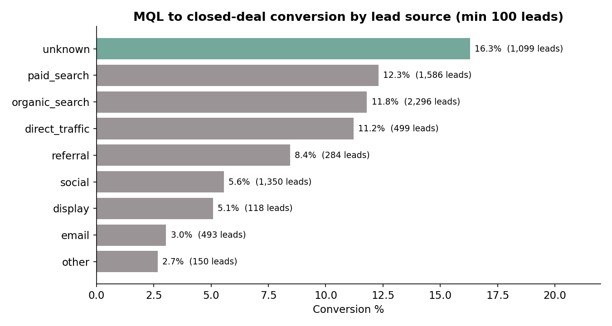

# Marketing Funnel and Lead Conversion (Olist)

How a marketplace turns marketing leads into sellers: funnel conversion by
channel, landing page and segment, the sales cycle in days, and where the
funnel leaks. Real data, advanced SQL and Python.

## The business question

Olist's sales team generates thousands of marketing-qualified leads (MQLs) from
companies that want to sell on the marketplace. Which channels actually produce
signed sellers, how long does closing take, and where should the next marketing
real go?

## Headline findings

- **10.5%** of 8,000 MQLs became closed deals (842 of 8,000 = 10.525% exactly; Jun 2017 - Nov 2018).
- **Search converts, social and email do not:** paid search 12.3% and organic
  search 11.8%, vs social 5.6% and email 3.0%.
- **The median deal closes in 14 days**, but the slowest 10% take 162+ days.
- **Home decor, health & beauty and car accessories** are the top won segments
  (105, 93 and 77 deals).
- **Mid-size online sellers sign most:** "online_medium" leads are 332 of 842
  wins; 70% of wins are resellers, 29% manufacturers.
- **45.1% of won leads** (380 of 842) have a seller_id that appears in the
  available Olist e-commerce sellers dataset from Project 1 - the two
  datasets link on seller_id. Absence does not prove a seller never sold.

Full write-up with recommendations and limitations: [docs/findings_and_recommendations.md](docs/findings_and_recommendations.md)

## Repository layout

    sql/01_schema_and_load.sql   MySQL 8 schema + LOAD DATA for the 2 raw tables
    sql/02_core_analysis.sql     CTEs, window functions, conversion, cycle length, rep productivity
    notebooks/funnel_analysis.py full reproducible pipeline (validation -> metrics -> charts)
    visuals/                     charts generated by the pipeline
    data-exports/                analysis exports (conversion by origin, top pages, segments, monthly)
    docs/                        findings, recommendations, limitations

## How to run

1. Download the data (see [data/README.md](data/README.md)) into `data/`.
2. `pip install -r requirements.txt`
3. `python notebooks/funnel_analysis.py` - validation checks run first and stop
   the pipeline on failure.
4. SQL: load `sql/01_schema_and_load.sql` in MySQL 8, then run
   `sql/02_core_analysis.sql` query by query. The MySQL scripts are written
   and their logic validated via SQLite/pandas, but not yet executed on a
   live MySQL 8 server - see docs/review/MYSQL_TESTING.md.

## Data source and license

Dataset: **Marketing Funnel by Olist**, published on
[Kaggle](https://www.kaggle.com/datasets/olistbr/marketing-funnel-olist).
License: **CC BY-NC-SA 4.0** - credit Olist, non-commercial use, share alike.
Row and column counts verified against the raw files on 17 Oct 2026
(8,000 MQLs x 4 columns; 842 closed deals x 14 columns).

The same query logic in `sql/02_core_analysis.sql` was validated against SQLite
and pandas on the identical files; MySQL 8 is the target dialect.
